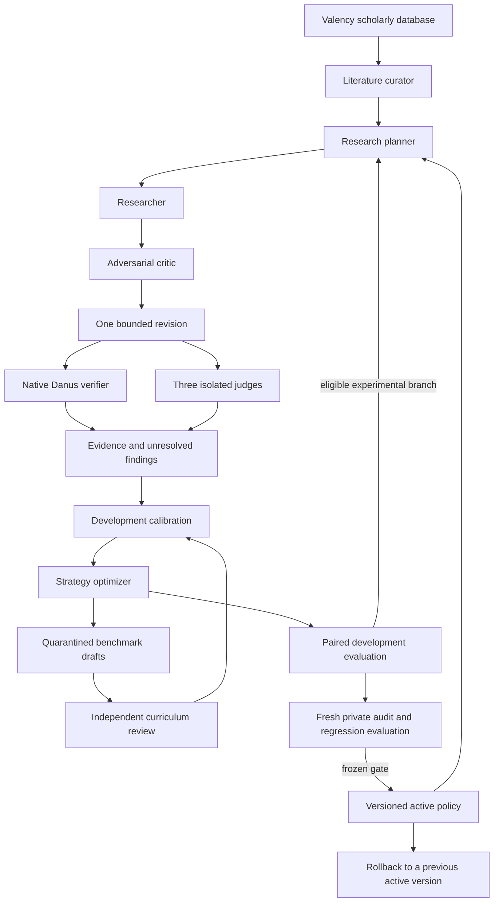

# Danus RSI Research

A bounded research-agent system for graduate mathematics and theoretical physics, built on [Danus](https://github.com/frenzymath/Danus) and the preceding Danus Math Panel benchmark. It runs research workflows, measures proposed verifier strategies, and maintains an auditable history of experiments.

**Status: experimental infrastructure, version 0.1.0.** Offline tests and scripted demonstrations validate software behavior. No live research campaign, scientific discovery, or measured model improvement is claimed. The default model is `gpt-6-astra`, through the existing Danus ChatGPT-subscription backend.

## What runs



The software schedules role dependencies and runs the three judge sessions concurrently. Every role has a fresh session and a narrow structured output. Agents reason in text and LaTeX; mathematical computation, browsing, shell execution, and subagent tools are disabled in the candidate/judge CLI sessions. Valency retrieval occurs through the orchestrator's separate adapter.

RSI here means recursive revision of **verifier strategy text and proposed benchmark tasks**. The solver strategy and curriculum focus remain fixed during verifier experiments, because labeled proof verification does not measure proof generation. It does not train model weights or let agents rewrite evaluator code. A candidate can become the next *development branch* after improvement on development cases. Changing the active policy requires a fresh independently reviewed audit batch. A draft's own reference is never sufficient to admit it as trusted benchmark data.

## Quick start: no credentials required

Python 3.11 or newer; the core uses only the standard library.

```bash
git clone https://github.com/sliu778/danus-rsi-research.git
cd danus-rsi-research
python -m danus_rsi init
python -m danus_rsi demo --cycles 2 --limit 4
python -m danus_rsi status
python scripts/check.py
```

The repository is private, so cloning requires GitHub access. The demonstration uses deterministic responses and creates HTML, Markdown, JSON, and call evidence under `.state/`. Its deliberately conflicting votes exercise abstention; they are not model scores. An example summary is in [docs/demo-report.html](docs/demo-report.html).

Optional console entry point: `python -m pip install -e .`, then use `danus-rsi` in place of `python -m danus_rsi`. No package installation is needed when running from the repository root.

## Start with the existing Danus installation

Run live commands **inside Linux/WSL**, with the existing `/opt/danus` installation and its verifier service. The helper selects that runtime automatically when present:

```bash
# From this repository inside the Danus WSL distribution:
bash scripts/run.sh init
/opt/danus/bin/codex login status
# If sign-in is missing, complete this in your own terminal:
/opt/danus/bin/codex login --device-auth

# Start the existing native verifier from its own directory:
(cd /opt/danus && bash scripts/services.sh up verify)

# Four public development problems, with independent judge panels:
bash scripts/run.sh benchmark --limit 4 --max-calls 32

# Two bounded cycles of verifier-strategy development:
bash scripts/run.sh improve --cycles 2 --limit 8 --max-calls 160

# A research campaign followed by development RSI:
bash scripts/run.sh run \
  --objective 'Study sufficient hypotheses for controlled EFT power counting on nontrivial backgrounds' \
  --domain theoretical-physics --cycles 1 --limit 8 --max-calls 128
```

From Windows, enter the installed distribution with `wsl -d Danus -u danus`. Windows paths are available under `/mnt/c/`. `DANUS_ROOT` can select another existing installation. See [environment and startup](docs/environment.md) for the exact local path and dependency checks. Live commands check subscription login and the native verifier's deployment PID. They do not fall back to an OpenAI API key.

All runs have a persisted call budget and deadline. The default deadline is four hours; individual model calls are capped at ten minutes and native checks at sixteen minutes. These are upper bounds, not time estimates. Each native request counts as one call; native-service internal tokens/requests are not observable. See [configuration](config.example.json).

## Valency as the research database

Valency supplies searchable scholarly records, versioned paper identities, abstracts when requested, and permalinks. The connected service currently exposes research discovery/export tools, not arbitrary application-table writes. Consequently:

| Data | System of record |
|---|---|
| Scholarly papers and discovery | Valency |
| Retrieved metadata and query provenance | Local immutable Valency snapshots |
| Runs, jobs, policies, evidence, audit reservations | SQLite in `.state/research.sqlite3` |

The repository includes ten real metadata records retrieved through the connected Valency service. They are **literature leads**, not verified claims or evaluation labels. No paper full text is copied into the repository.

```bash
python -m danus_rsi literature
python -m danus_rsi literature --import-file exported-valency-result.json

# Optional standalone direct connection; obtain a token from your own Valency settings.
python -m pip install '.[valency]'
# Set VALENCY_TOKEN in the environment, without placing it in version control.
python -m danus_rsi literature --query 'effective field theory power counting consistency'
```

`run --refresh-literature` performs a fresh search before planning. Without that flag, research uses locally imported Valency records. Desktop connector authorization is separate from standalone MCP authorization; the project never extracts desktop credentials. [Valency setup and data contract](docs/valency.md).

## Benchmark and promotion protocol

The public development suite contains **18 problems**: 12 graduate/research-style mathematics problems and 6 theoretical physics problems, with **18 labeled calibration candidates**. References and labels are authored examples, not independently expert-certified. Physics coverage includes driven quantum systems, Noether energy balance, EFT dimensions, canonical fluctuations, RG conventions, and scalar instabilities.

Judges independently examine correctness, adversarial counterexamples, and completeness. Physics prompts also check dimensions, symmetries, limits, and validity regimes. A strict acceptance requires a consistent native Danus acceptance and all three judges passing the frozen rubric. Disagreement or unresolved reference concerns produce abstention. Infrastructure errors remain errors, not incorrect mathematical answers.

Promotion needs a private, independently reviewed batch with at least 20 cases, at least ten problem families, and at least five valid and five invalid candidates in each domain. The same batch, normalized problem statement, or declared family cannot be reused in another audit. Exact/family checks cannot detect every semantic paraphrase; an independent custodian must maintain the split.

```bash
# Use a candidate policy ID returned in the improvement report/status.
bash scripts/run.sh audit --candidate CANDIDATE_ID \
  --file /path/outside/repository/private-audit.json --max-calls 512 --promote

# Or activate an eligible completed audit later:
python -m danus_rsi promote EVALUATION_ID
python -m danus_rsi rollback PREVIOUS_ACTIVE_POLICY_ID
```

The gate requires complete coverage, at least a 0.05 increase in balanced accuracy, no increase in false acceptances, no per-domain regression, and no loss on the frozen development regression cases. These are finite-sample engineering criteria, not a statistical guarantee of generalization. A failed/interrupted audit consumes its batch. [Full protocol and audit format](docs/protocol.md).

## Evidence, continuation and limits

```bash
# Reuse the exact original command, configuration and selection, adding its run ID:
bash scripts/run.sh improve --cycles 2 --limit 8 --max-calls 160 --resume RUN_ID
# Retry cached transport errors once, within the same remaining budget/deadline:
bash scripts/run.sh improve --cycles 2 --limit 8 --max-calls 160 --resume RUN_ID --retry-errors
python -m danus_rsi report RUN_ID
```

State includes content-addressed artifacts, call inputs/results, schema-validated outputs, policy lineage, and a hash-linked event history. Atomic reservations prevent concurrent overspending; leases reject stale writers. The original deadline and reserved calls survive interruption. The database owner remains trusted: hashes detect accidental changes, not an adversary with full filesystem access.

Fresh model sessions are operationally separate but share a model family, so correlated errors remain possible. This initial version does not provide a formal proof kernel, physical experiments, automatic novelty determination, autonomous paper publication, or a certified expert benchmark. Research findings remain proposals for independent review, including those supported by all automated judges. It does not write the upstream Danus fact graph.

See [architecture](docs/architecture.md), [provenance](docs/provenance.md), and [validation](docs/validation.md). Licensed under Apache-2.0.
