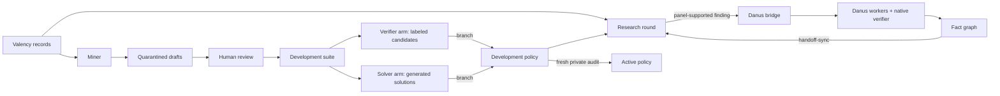

# Architecture and persistence

The orchestration layer is an explicit bounded workflow over the existing Danus runtime. It does not launch the upstream indefinite worker loop, modify Danus private worker memory, or directly write its fact graph. Its one write into a Danus project is an operator-confirmed `danus assign` ([bridge](bridge.md)).

| Component | Responsibility |
|---|---|
| `cli.py` | Explicit commands, configuration, state selection, campaign rounds and arm alternation |
| `engine.py` | Dependencies, concurrent judges, research stages, verifier and solver development cycles, paired audits, mining |
| `agents.py` | Role prompts, structured responses, subscription transport and scripted fixtures |
| `transport.py` | Adapted Math Panel isolation, Codex event audit, rubric, native HTTP checks |
| `protocol.py` | Validation, split checks, deterministic metrics, frozen verifier and solver gates, arm field locks |
| `store.py` | Transactions, persistent budgets, worker leases, immutable artifacts, lineage, shared audit registry |
| `valency.py` | Scholarly search/import with provenance through Valency MCP; mining eligibility by date and category |
| `bridge.py` | Danus handoff through `danus assign`; read-only tracing of native verifier outcomes |
| `report.py` | Escaped HTML/Markdown summaries and local full JSON evidence |

## The loop

Benchmark growth, verifier quality and solver quality feed each other only through gates: drafts through human review, strategies through paired development gates and fresh audits, findings through the Danus verifier.

## Scheduling

A research round has a curator, planner, and one to three subproblems. Each subproblem has a researcher, critic, at most one revision, a native verification request and three judge sessions. Subproblems execute in deterministic order; panel sessions run in a bounded thread pool. A development cycle evaluates the current policy, asks an optimizer for one revision, evaluates that revision on the same examples, then selects a branch using the frozen development gate. A verifier cycle re-judges fixed labeled candidates; a solver cycle generates fresh attempts and judges them under unchanged verifier guidance. `run --arm alternate` (the demo default) alternates the two arms across rounds, so each round changes only one side.

The campaign passes the status and evidence IDs of prior findings into later planning, together with any Danus facts from the latest `handoff-sync`. A model-supported finding remains a proposal, not an established fact; only a fact in the Danus graph is labeled as verified. The reference-free research path explicitly asks judges to check missing dependencies. New task references remain quarantined.

## Persistence

SQLite uses WAL and `BEGIN IMMEDIATE` for mutations. Every model/native request first reserves one budget unit and a lease. A completed job is returned from cache only when its complete request fingerprint matches. Expired running leases may be reclaimed once, reserving another call; the previous lease token cannot commit a result afterward. An explicit `--retry-errors` permits one retry of a cached transport error. Failed, abandoned and timed-out attempts remain charged. Audit batches have stricter single-use rules.

| Table | Contents |
|---|---|
| `artifacts` | Content-addressed policies, datasets, Valency snapshots, papers, findings, drafts, Danus handoffs/syncs and reports |
| `events` | Timestamped event chain linked by SHA-256 |
| `runs` | Exact manifest, code/data hashes, backend mode, resource limits and status |
| `jobs` | Request fingerprints, status, attempts, lease token, result |
| `lineage` | Candidate policy, parent policy and originating run |
| `audit_batches` / `audit_cases` | One-use reservations and consumed family/statement fingerprints, shared by verifier and solver audits |
| `evaluations` | Paired outcomes, gate decision, audit hash, regression/code versions |
| `meta` | Database schema version and current active policy |

The event chain helps detect accidental modification. It is not an externally anchored signature, and a database administrator can rewrite the database. Keep `.state/` private and back it up as a complete unit while no process is writing, or use SQLite's online backup API. Do not copy only the main database while a WAL writer is active. Running Windows and WSL processes against the same database simultaneously is unsupported; prefer one execution host per state directory.

## Resource accounting and failure semantics

The budget counts orchestration calls, not money or tokens. Native service internal requests are not exposed; token usage is retained only when the CLI returns it. Calls are bounded by remaining run time, and CLI timeout kills the subprocess group. A native HTTP timeout stops waiting but cannot cancel work already accepted by the verifier service; that service retains its own timeout. No unlimited retries, daemon, or scheduled automation is started.

An error in any judge or the native verifier invalidates that evaluation. Failed research/optimizer stages stop the workflow and leave evidence available. A `complete` run means its scheduled workflow ended, not that the mathematics is correct. A run interrupted by its budget has `budget-exhausted` status. Resume requires the same manifest, selection, configuration and code, and does not extend the original deadline.

## Isolation

Live calls run in an ephemeral directory using Danus's shared CLI command builder, a read-only sandbox, schema output, ignored user configuration and disabled shell/apps/plugins/browsing/agent features. Observed tool events or unknown item types invalidate a call. Inherited OpenAI API credentials are removed; ChatGPT subscription login is required. This limits accidental cross-role context and tool contamination, but it is not a security proof against a compromised model runtime.

Valency is accessed by a separate adapter with a bearer token in memory. Tokens are neither included in model prompts nor saved as provenance. The standalone token is not inferred from the connected desktop app. Literature content is untrusted data. Roles cannot make arbitrary MCP calls or submit papers/feedback.
